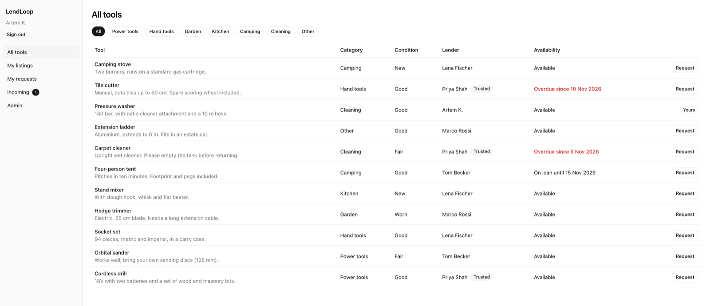
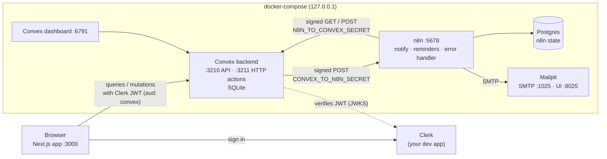
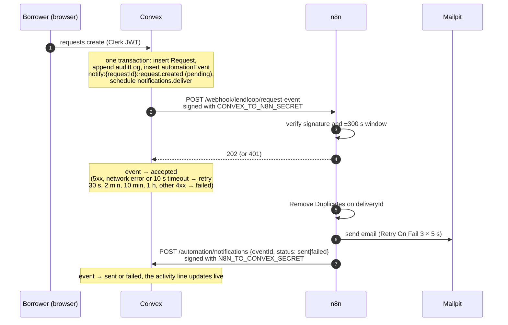
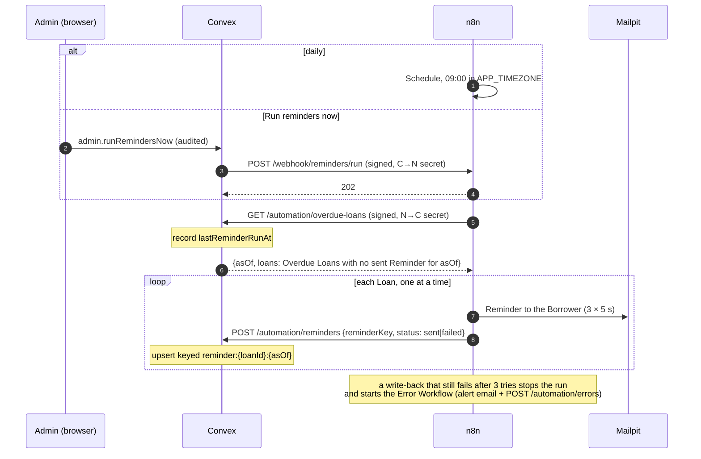
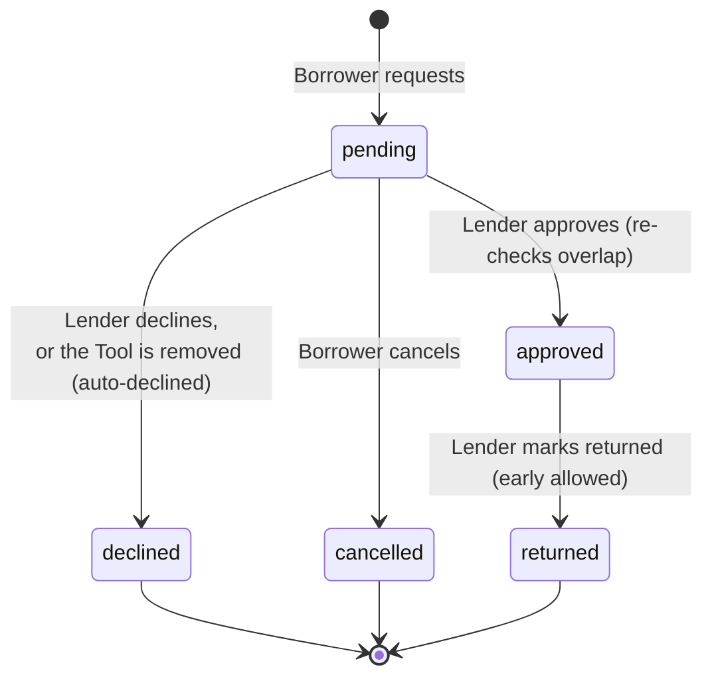

# LendLoop

Borrow what you need. Lend what you don't.

## 1. Overview

LendLoop is a neighbourhood tool-lending board. Members list the Tools they own, borrow other
Members' Tools for a date range, and get an email whenever a Request they are part of changes.
Borrowers whose Loan is Overdue get a daily Reminder. Admins moderate Tools, oversee Loans, mark
Trusted Lenders and watch an Automation health panel where every failed email or workflow run shows
up and can be retried.



**Stack:** Next.js 16 (App Router) with Tailwind and shadcn/ui, Clerk for sign-in, a self-hosted
Convex backend, n8n 2.47 for the email automations and Mailpit to catch every email. Everything
except Clerk runs locally in docker-compose.

Domain terms (Tool, Member, Lender, Borrower, Request, Loan, Overdue, Notification, Reminder…) are
defined in [`GLOSSARY.md`](GLOSSARY.md). The hard-to-reverse decisions are in [`docs/adr/`](docs/adr/).

## 2. Quick start

Prerequisites: Docker, Node 22 (run `nvm use` in the repo, it reads `.nvmrc`) and a free Clerk
account. Ports 3000, 3210, 3211, 5678, 6791, 8025 and 1025 must be free.

### Clerk checklist (about 3 minutes)

LendLoop can't ship anyone's Clerk keys, so each reviewer brings a free development app.

1. Create an application at https://dashboard.clerk.com. A development instance with email sign-in
   is fine.
2. **Configure → Integrations → Convex**: activate it and copy the **Frontend API URL**
   (`https://<verb-noun-00>.clerk.accounts.dev`).
3. **Sessions → Customize session token**: add these claims and save. Convex only sees what is in
   the session token, and LendLoop needs your email and name. Without `email`, sign-in stops with
   a message pointing back here.
   ```json
   {
     "name": "{{user.full_name}}",
     "given_name": "{{user.first_name}}",
     "email": "{{user.primary_email_address}}"
   }
   ```
4. **Configure → API keys**: copy the **Publishable key** (`pk_test_…`) and the **Secret key**
   (`sk_test_…`).

### Run it

```sh
cp .env.example .env        # then paste the three Clerk values into it
docker compose up -d
npm install
npm run setup               # checks the Clerk values, configures and pushes Convex, seeds demo data
npm run dev                 # Next.js and Convex dev side by side
```

Put the values from the checklist into `.env` as `CLERK_FRONTEND_API_URL` (step 2), and
`NEXT_PUBLIC_CLERK_PUBLISHABLE_KEY` and `CLERK_SECRET_KEY` (step 4). If any is missing or
malformed, `npm run setup` stops before touching Docker or Convex and prints the checklist again.
It is safe to re-run.

Open http://localhost:3000 and sign in. The board already shows demo data. Then make yourself an
Admin with demo Requests of your own:

```sh
npm run demo -- you@example.com     # the email you signed in with
```

To only grant Admin, run `npm run promote -- you@example.com`. Both need you to have signed in once.

## 3. Local URLs

| Service          | URL                   | Notes                                               |
| ---------------- | --------------------- | --------------------------------------------------- |
| App              | http://localhost:3000 |                                                     |
| Convex dashboard | http://127.0.0.1:6791 | Admin key: `CONVEX_SELF_HOSTED_ADMIN_KEY` in `.env` |
| n8n              | http://localhost:5678 | `admin@lendloop.local` / `LendLoop-dev-1`           |
| Mailpit          | http://127.0.0.1:8025 | Catches every email; nothing leaves the machine     |

All ports are bound to 127.0.0.1. The Convex API (3210) and HTTP actions (3211) are used by the
app, the CLI and n8n.

## 4. Demo walkthrough

After `npm run demo -- you@example.com`, reload the app.

1. **Look around signed out.** Open http://localhost:3000 in a private window: only the names and
   Categories of Available Tools, no Lenders, dates or descriptions.
2. **Borrow.** In **All tools**, pick a Tool marked "Available" (Priya's Cordless drill has the
   Trusted badge), press **Request**, choose dates in the drawer and **Send request**. **My
   requests** shows it as pending with the activity line "Request email to lender sent" within a
   few seconds, and Mailpit has "New request for your Cordless drill" for Priya.
3. **Approve.** **Incoming** shows a pending count. Marco wants your Pressure washer: press
   **Approve**. Mailpit gets "Your request for Pressure washer was approved" for Marco. Click the row
   to open the drawer with the Request's full timeline.
4. **Run reminders.** You're Borrower on an Overdue Loan (Priya's Tile cutter, 2 days late). Open
   **Admin** and press **Run reminders now**. Mailpit gets a Reminder for you and one for Tom
   (Carpet cleaner, 3 days late). The activity line in **My requests** reads "Reminder sent".
   Press it again: no second email, because each Loan gets at most one Reminder a day.
5. **Break email and watch it surface.** Run `npm run demo:break-smtp`, then request another Tool.
   The activity line turns red ("Request email to lender failed"), and **Admin → Automation
   health** lists the event. Run `npm run demo:fix-smtp` and press **Retry**: the email arrives and
   the line turns back to "sent".

**Expect "Reminder run missed".** The demo data has Overdue Loans, but no Reminder run has
happened yet. From 10:00 in `APP_TIMEZONE` (UTC by default), the hourly check at `:05` UTC records a
"Reminder run missed" workflow error in Automation health, once per day, until a run happens that
day. Pressing **Run reminders now** counts as that day's run; rows already recorded stay in the
list as history. It's the alert doing its job, not a bug.

### Demo data

`npm run setup` runs the base seed (`internal.seed.base`), which is skipped if any Tool exists:

- 4 demo Members on `@example.com`; Priya Shah is a Trusted Lender. They have no Clerk account (their
  issuer isn't Clerk), so nobody can sign in as them.
- 8 Tools across every Category.
- 6 Requests: pending, approved (on loan now), returned, declined, cancelled, and one Overdue Loan
  (Tom has had Priya's Carpet cleaner for 3 days too long).
- An activity line on every Request, from `automationEvents` written as already sent. Seeding never
  emails anyone.

Every seeded row has `demo: true`.

`npm run demo -- <email>` (`internal.seed.demo`) fails with a clear message if that Member hasn't
signed in yet. It makes them an Admin and gives them:

- their own Pressure washer with a pending incoming Request from Marco;
- an Overdue Loan as Borrower (Priya's Tile cutter, due back 2 days ago);
- a pending Request of their own (Lena's Camping stove).

Running it again for the same email changes nothing.

`npm run reset` (`internal.seed.reset`) deletes every row in every table, the audit log and your own
`users` row included, cancels pending scheduled jobs and re-runs the base seed. Your account comes
back as a plain Member on your next page load, so run `npm run demo` again afterwards.

## 5. Architecture



- **Next.js** renders the UI and holds no business rules. Pages call `auth.protect()` for UX only;
  every rule is enforced in Convex ("UI hides, Convex decides").
- **Convex** owns all data, access control, the Request lifecycle and the outbox of automation
  events. Its HTTP actions are the only door n8n has into the data.
- **n8n** sends every email. It has three workflows in `n8n/workflows/`: request notifications,
  overdue reminders and the error handler. `n8n/entrypoint.sh` renders the credentials from the
  container env, imports credentials and workflows, and publishes them on every start, so nobody
  configures n8n by hand.
- **Mailpit** stands in for SES.

### Notification flow



### Reminder flow



## 6. Data model and the Request lifecycle

Schema: [`convex/schema.ts`](convex/schema.ts).

| Table              | What it holds                                                                                                                                                                       |
| ------------------ | ----------------------------------------------------------------------------------------------------------------------------------------------------------------------------------- |
| `users`            | One row per Member, keyed by Clerk `tokenIdentifier`: `name`, `firstName`, `email`, `role` (`user` = Member, `admin`), `trustedLender`                                              |
| `tools`            | `ownerId`, `name` (≤ 80), `category`, `condition`, `description` (≤ 500); soft delete with `removedAt`, `removedBy`, `removalReason`                                                |
| `requests`         | `toolId`, `borrowerId`, `lenderId` (copied from the Tool), `startDate`/`endDate` (`YYYY-MM-DD`), `status`, `decidedAt`, `returnedAt`, `cancelledAt`; no free text                   |
| `automationEvents` | One row per Notification, Reminder or workflow error: `kind`, `event`, unique `idempotencyKey`, `status` (`pending → accepted → sent \| failed`), `attempts`, sanitised `lastError` |
| `automationState`  | `lastReminderRunAt`, so a dead n8n schedule is visible from Convex                                                                                                                  |
| `auditLog`         | Append-only: `actorId`, `action`, `target`, `at` for every Request transition and Admin action                                                                                      |

Category (`power_tools | hand_tools | garden | kitchen | camping | cleaning | other`) and Condition
(`new | good | fair | worn`) are fixed unions defined once in `convex/lib/toolFields.ts` and shared
by the schema, the validators and the UI. Availability is worked out when read, never stored.

A Loan is not a table: it's a Request in the `approved` state ([ADR 0002](docs/adr/0002-one-request-record-with-a-lifecycle.md)).
It is Overdue once its `endDate` is before today in `APP_TIMEZONE`; a Loan due back today isn't.



Every transition goes through `transitionRequest` in `convex/lib/requestLifecycle.ts`, which checks
this table and, in the same transaction, appends the audit row and queues the Notification.

Rules on dates: no start before today, end not before start, at most 30 days, and no overlap with an
existing Loan (`CONFLICT`). Pending Requests may overlap each other; approval re-checks overlap
inside the transaction, so two racing approvals can't double-book a Tool. A Request can still be
approved after its start date as long as its end date hasn't passed. A Borrower has at most one
pending Request per Tool.

## 7. Access control

Clerk proves identity; Convex decides everything else ([ADR 0004](docs/adr/0004-roles-in-a-convex-users-table.md)).

- **Wrappers.** Every public function is built from a wrapper in
  [`convex/lib/functions.ts`](convex/lib/functions.ts): `publicQuery`, `memberQuery`,
  `memberMutation`, `adminQuery`, `adminMutation`, plus `signedInMutation` for `users.ensureMe`,
  which runs before the caller's row exists. The wrapper loads the caller's `users` row and injects
  it as `ctx.me`. Member wrappers throw `UNAUTHENTICATED` without one; Admin wrappers also throw
  `FORBIDDEN` unless `role === "admin"`.
- **Lint-enforced.** An ESLint `no-restricted-imports` rule bans the raw `query`/`mutation`/`action`
  builders everywhere in `convex/` except the wrapper module, so a new function can't skip the check
  by accident. `convex/lint.test.ts` pins the rule.
- **Ownership comes from the caller.** `ownerId`, `borrowerId` and `lenderId` are derived from
  `ctx.me`, never taken from arguments. Records you may not see return `NOT_FOUND`, not
  `FORBIDDEN`, so ids can't be probed.
- **Typed errors.** `UNAUTHENTICATED | FORBIDDEN | NOT_FOUND | CONFLICT | INVALID`, mapped to
  messages in `lib/errors.ts`. Every function validates its arguments; strings are trimmed and capped.
- **No Admin bypass.** Admins follow the normal rules in Member functions; their powers exist only in
  `admin.*`. Admin is granted only by `npm run promote` / `npm run demo`, which run internal
  functions with the deployment admin key.
- **UI hides, Convex decides.** The sidebar hides Admin for Members and each row shows only the
  actions valid for its status, but the same checks run on the server.

| Function                                                      | Who may call it           | Rule                                                                                                                               |
| ------------------------------------------------------------- | ------------------------- | ---------------------------------------------------------------------------------------------------------------------------------- |
| `tools.listPublic`                                            | anyone                    | `{ name, category }` of Available Tools only                                                                                       |
| `users.ensureMe`                                              | signed in                 | creates or refreshes the own row from the token; never sets `role` or `trustedLender`                                              |
| `users.me`                                                    | anyone                    | own row, or `null` when signed out                                                                                                 |
| `tools.listBoard`                                             | Member                    | non-removed Tools with Lender display name, Trusted badge and availability; no email                                               |
| `tools.listMine`, `tools.create`                              | Member                    | own Tools; `ownerId` is the caller                                                                                                 |
| `tools.update`, `tools.remove`                                | the Lender                | `remove` is `CONFLICT` while an approved Loan is running or upcoming; pending Requests are auto-declined                           |
| `requests.create`                                             | Member                    | not own Tool (`INVALID`), date rules, no Loan overlap (`CONFLICT`), one pending Request per Tool                                   |
| `requests.cancel`                                             | the Borrower              | pending only                                                                                                                       |
| `requests.approve`, `.decline`, `.markReturned`               | the Lender                | per the lifecycle; approve re-checks overlap                                                                                       |
| `requests.listMine`, `.listIncoming`, `.countPendingIncoming` | Member                    | by the caller's id                                                                                                                 |
| `requests.get`                                                | Borrower, Lender or Admin | with its timeline; anyone else gets `NOT_FOUND`                                                                                    |
| `admin.*`                                                     | Admin                     | remove any Tool with a reason (even on loan), list Loans, Lenders and Tools, set Trusted Lender, retry an event, run reminders now |
| `users.promote`, seeds, automation write-backs                | internal                  | CLI with the admin key, or HTTP actions after signature verification                                                               |

**Beyond the spec's function list.** A few functions and fields exist that the spec doesn't name:
`requests.countPendingIncoming` (the sidebar badge on Incoming), `admin.listLenders` (the Lenders
table with Tool counts), `admin.listTools` (every Tool, removed ones included, for the Admin Tools
table), `admin.automationHealth` (the Automation health panel) and the Overdue filter on
`admin.listLoans`. The schema adds the `automationState` table (the last Reminder run),
`users.by_email` (for `npm run promote`), and on `automationEvents` the `recipientId`, `toolId`
(Tool-level Notifications), `retryGeneration` (Admin retries) and the workflow-error fields
`workflowName`, `failedNode` and `executionUrl`.

The full matrix (each function × signed out, other Member, party, Admin) is table-driven in
[`convex/tools.test.ts`](convex/tools.test.ts), [`convex/requests.test.ts`](convex/requests.test.ts)
and [`convex/admin.test.ts`](convex/admin.test.ts); the wrappers themselves are tested in
[`convex/lib/functions.test.ts`](convex/lib/functions.test.ts).

## 8. Integration security and reliability

### Signatures ([ADR 0003](docs/adr/0003-signed-webhooks-one-secret-per-direction.md))

- Headers `X-LendLoop-Timestamp: <unix seconds>` and `X-LendLoop-Signature: v1=<hex>`, where
  `hex = HMAC-SHA256(secret, "<ts>.<METHOD>.<path>.<rawBody>")`. Signed GETs have an empty body.
- The receiver rejects with 401 when the timestamp is more than 300 s off or the signature doesn't
  match in a constant-time comparison. Convex computes it over the exact bytes it sends; n8n verifies
  over the webhook's raw body.
- **One secret per direction:** `CONVEX_TO_N8N_SECRET` signs Convex → n8n, `N8N_TO_CONVEX_SECRET`
  signs n8n → Convex. Convex holds both as function env vars. n8n holds them only in Crypto
  credentials rendered at start from `n8n/credentials.template.json`; workflows can't read env
  (`N8N_BLOCK_ENV_ACCESS_IN_NODE=true`), and `npm run n8n:export` fails on anything secret-shaped.
- Endpoints: n8n `POST /webhook/lendloop/request-event` and `POST /webhook/reminders/run`; Convex
  `POST /automation/notifications`, `GET /automation/overdue-loans`, `POST /automation/reminders`
  and `POST /automation/errors`. The Convex side is in [`convex/http.ts`](convex/http.ts) and
  [`convex/lib/signature.ts`](convex/lib/signature.ts).

### Idempotency keys

Replays inside the 300 s window pass the signature check, so every write is idempotent.

| What                | Key                                          | Effect of a repeat                                                                                |
| ------------------- | -------------------------------------------- | ------------------------------------------------------------------------------------------------- |
| Notification        | `notify:<requestId>:<event>` (Convex row)    | One event per Request and event; checked in the same transaction as the insert                    |
| Notification in n8n | `deliveryId` = `<eventId>#<retryGeneration>` | n8n's Remove Duplicates drops it; an Admin retry bumps the generation so it gets through once     |
| Reminder            | `reminder:<loanId>:<asOf>`                   | `sent` → no-op `{duplicate: true}`; `failed` → updated, `attempts + 1`; always 200 on valid input |
| Workflow error      | `workflow_error:n8n:<executionId>`           | One row per failed n8n execution                                                                  |
| Missed Reminder run | `workflow_error:missed_run:<date>`           | One row per day                                                                                   |

### Retries

- **Convex → n8n delivery:** 202 → `accepted`. 5xx, network error or a 10 s timeout → retried after
  30 s, 2 min, 10 min and 1 h, then `failed` after 5 attempts. Any 4xx (including 401) or any other
  2xx → `failed` at once, because it's a configuration error: the workflow answers 202 from its
  dedupe path, so a 200 or 204 means a request got past it.
- **n8n email nodes:** Retry On Fail 3 × 5 s. A failed Reminder email is written back as `failed`
  and the loop carries on with the next Borrower (one Loan per iteration, so a node retry never
  re-sends to others).
- **n8n write-backs:** 3 × 5 s. A write-back that still fails stops the run.
- **Admin Retry** (`admin.retryEvent`, audited) keeps the row and its idempotency key. A
  Notification is delivered again with a fresh backoff; a Reminder triggers a Reminder run, and only
  while its Loan is still Overdue.

### Failure visibility

No automation fails silently.

- **Members** see a failed Notification or Reminder in red on the Request's activity line and in its
  drawer ("Request email to lender failed 2 days ago · retrying", "Reminder failed").
- **Error Workflow** (`LendLoop: error handler`, `n8n/workflows/error.json`) is the
  `settings.errorWorkflow` of both workflows, and it must be published or n8n refuses to call it.
  For every failed production run it emails `ADMIN_ALERT_EMAIL` (default `alerts@lendloop.local`, in
  Mailpit) with the workflow, the failed node, the error (addresses scrubbed) and the execution
  link, and no payload. It then makes a signed `POST /automation/errors`, which records a
  `workflow_error`. The alert address reaches the workflow as a `${ADMIN_ALERT_EMAIL}` placeholder
  that `entrypoint.sh` renders at start; `npm run n8n:export` puts the placeholder back.
- **Stuck events:** an hourly Convex cron (`:17` UTC) marks events `failed` with "No confirmation
  from n8n" once they have waited over 30 minutes for n8n's write-back. That covers `accepted` Notifications
  and also retried Reminders still `pending`, because a retried Reminder has no Convex-side
  delivery and waits as `pending`.
- **Missed run:** Convex crons are UTC-only, so an hourly cron (`:05` UTC) checks whether it's past
  10:00 in `APP_TIMEZONE`. If any Loan is Overdue and the last Reminder run wasn't today, it records
  a "Reminder run missed" `workflow_error`, once per day.
- **Run reminders now:** if Convex can't start the n8n run (not configured, unreachable, non-2xx),
  that's recorded as a `workflow_error` too.
- **Automation health** (Admin page) lists failed and stuck events with **Retry**, the 20 most
  recent workflow errors with links to their n8n executions, and the last Reminder run time.
  `tool.removed` Notifications have no Request, so they show here with their Tool's name.
- n8n keeps failed executions (`EXECUTIONS_DATA_SAVE_ON_ERROR=all`) and prunes after 14 days.
  Successful ones aren't saved (`EXECUTIONS_DATA_SAVE_ON_SUCCESS=none`), because they hold email
  text and addresses.

### Residual risks

- **Email sent, write-back lost.** If n8n sends a Reminder but every write-back retry fails, the
  Reminder isn't recorded as `sent`, so a later run the same day sends one extra Reminder. The
  stopped run fires the Error Workflow, so it's visible. For a Notification, the event stays
  `accepted` until the stuck-event cron marks it `failed`; an Admin who retries it then sends the
  email a second time, because a retry gets a new `deliveryId`.
- **Retrying an earlier day's Reminder.** A Reminder run only works on today's `asOf`. Retrying a
  `failed` Reminder from an earlier day sends today's Reminder (new key) if the Loan is still
  Overdue, but leaves the old row `pending`. The stuck-event cron marks it `failed` again at its
  first check after 30 minutes, so it reappears in Automation health. Ignore it once today's
  Reminder shows `sent`.
- **The Error Workflow fails itself.** Then the only trace is n8n's execution log.
- **An event fails while n8n is down for hours.** After the last retry (about 1 h 12 min) it is
  `failed` and needs an Admin Retry; nothing re-sends it automatically.
- **A delivery action dies mid-run.** Configuration errors and n8n answers are all recorded, but if
  the Convex action itself crashes (a platform failure, not an n8n one), the Notification stays
  `pending` and "queued". Pending Notifications aren't swept as stuck because a scheduled retry can
  legitimately wait an hour.
- **A late write-back from an earlier delivery.** Write-backs are keyed by `eventId`, not
  `deliveryId`. If a stuck Notification is retried and the first delivery's `sent` arrives late, it
  settles the retry too, and the retry's own result is dropped as a duplicate.
- **A manual run counts as the daily run.** `lastReminderRunAt` is set by every signed Overdue
  Loans read, including "Run reminders now", so a dead 09:00 schedule goes unreported on a day an
  Admin ran reminders by hand. The query string isn't signed, so a flag there couldn't be trusted.
- **Date pickers use the browser's date.** The Request drawer bounds dates by the Member's local
  day, while Convex checks against `APP_TIMEZONE`. Near midnight a Member far from `APP_TIMEZONE`
  can pick a date Convex rejects; the error says why.

**Accepted in the pre-submission security review** ([#29](https://github.com/rtmkvtn/lendloop-test/issues/29)):

- **Replays inside the signature window.** There is no nonce, so a captured request can be replayed
  for 300 s. Every write is idempotent (table above), and replaying the reminder trigger only
  starts a run that skips Reminders already `sent`.
- **Committed dev-only secrets.** `.env.example` pins the Convex instance secret and admin key, the
  n8n encryption key and the HMAC secrets, and `docker-compose.yml` holds the n8n owner's password
  hash. They protect services bound to `127.0.0.1` only and are never valid elsewhere. gitleaks
  allowlists exactly the two values it would flag, so a real key pasted into the template still
  fails CI.
- **`script-src 'unsafe-inline'` in the CSP.** The CSP is static so pages stay prerenderable with
  Cache Components; a nonce would force every page to render dynamically. Everything else is
  locked down (`default-src 'self'`, `object-src 'none'`, `frame-ancestors 'none'`, `base-uri` and
  `form-action 'self'`), and `'unsafe-eval'` is dev-only. HSTS is sent by production builds only.
- **Failed n8n executions keep their data.** A failed run's execution, which can include the
  recipient's address and the email text, stays in n8n's database for 14 days so the Admin link
  can show what broke. Successful runs aren't saved. n8n is bound to `127.0.0.1`.
- **The Admin alert email isn't host-scrubbed.** It goes only to `ADMIN_ALERT_EMAIL`, and the
  operator needs the failing host. What Convex stores and shows is scrubbed.
- **`lastError` scrubbing is pattern-based.** It replaces emails, URLs, IP addresses, `host:port`
  and the host after `ENOTFOUND`/`EAI_AGAIN`, then caps the text at 200 characters. A bare internal
  hostname in some other phrasing would get through.
- **Dev-dependency advisories.** `npm audit` reports moderate issues in `deepmerge` (via the
  `shadcn` CLI) and `minimatch` (via `typescript-eslint`). Neither ships in the app; CI fails on
  high or critical advisories in runtime dependencies.
- **Per-row reads in Admin and Request queries.** `listTools`, `listLoans` and the Request rows
  read the Lender, Tool and events row by row. That is fine at neighbourhood scale; a bigger deployment
  would denormalise display names.

## 9. Data minimisation

| Audience             | Sees                                                                                                          |
| -------------------- | ------------------------------------------------------------------------------------------------------------- |
| Signed out           | `name` and `category` of Available Tools. Built field by field; a test checks those are the only keys         |
| Member on the board  | Tool name, Category, Condition, description, Lender display name, Trusted badge, availability. Never an email |
| Parties to a Request | The other party's display name, the dates, status and the activity timeline. Never the other party's email    |
| Admin                | Every Loan, Lender and Tool with display names. No emails in the UI either                                    |
| You                  | Your own name, email and role (`users.me`)                                                                    |

If Clerk sends no name, the stored name falls back to the email, and every query then shows
"A LendLoop member" instead, so an address never leaks through a name.

**What leaves Convex.** The Notification payload to n8n is exactly `eventId`, `deliveryId`, `sentAt`,
`event`, `recipient: { email, firstName }`, `tool: { name }`, `dates: { start, end }` and `link` (a
deep link to the Request). `tool.removed` carries `reason` instead of `dates`. One recipient per
event: created and cancelled go to the Lender; approved, declined, auto-declined and returned go to
the Borrower; `tool.removed` goes to the Lender. No other party's contact details, no descriptions.
The Overdue Loans response carries `asOf` and, per Loan, `loanId`, `reminderKey`, `borrowerEmail`,
`borrowerFirstName`, `toolName`, `endDate` and `daysOverdue`, nothing about the Lender. The
Error Workflow's alert and report carry the workflow name, node, a scrubbed error and the execution
link, never the payload.

**Why email is stored.** Notifications and Reminders are addressed from Convex, so the `users` row
keeps the email from the Clerk session token. It is refreshed on every sign-in and used for nothing
else. `lastError` strings are sanitised (email addresses, URLs, IPs and internal `host:port`
replaced by `[email]`, `[url]` or `[host]`, 200 characters max) because Members and Admins see them.

## 10. Environment variables

Everything lives in one gitignored `.env` created from `.env.example`. Docker compose, Next.js and
the scripts read it; `npm run setup` copies the function-side values into Convex with
`npx convex env set`. Every value except the three Clerk ones is a dev-only default: never reuse
them in production.

| Name                                             | Used by                                        | Dev default                                      | Production source                                                  |
| ------------------------------------------------ | ---------------------------------------------- | ------------------------------------------------ | ------------------------------------------------------------------ |
| `NEXT_PUBLIC_CLERK_PUBLISHABLE_KEY`              | Next.js                                        | none: from your Clerk dev app                    | Clerk production instance (`pk_live_…`), build-time config         |
| `CLERK_SECRET_KEY`                               | Next.js server (middleware)                    | none: from your Clerk dev app                    | Secrets Manager                                                    |
| `CLERK_FRONTEND_API_URL`                         | Convex `auth.config.ts` (set by setup)         | none: from your Clerk dev app                    | Clerk production Frontend API on your domain, in Convex env        |
| `NEXT_PUBLIC_CONVEX_URL`                         | Next.js browser client                         | `http://127.0.0.1:3210`                          | The Convex deployment URL                                          |
| `CONVEX_SELF_HOSTED_URL`                         | Convex CLI (setup, dev, scripts)               | `http://127.0.0.1:3210`                          | CI deploy only (`CONVEX_DEPLOY_KEY` on Convex Cloud)               |
| `CONVEX_SELF_HOSTED_ADMIN_KEY`                   | Convex CLI                                     | committed dev key                                | CI secret; never on developer machines                             |
| `CONVEX_INSTANCE_NAME`, `CONVEX_INSTANCE_SECRET` | compose: Convex backend                        | pinned so the dev admin key stays valid          | Not used on Convex Cloud; Secrets Manager if self-hosted           |
| `CONVEX_REV` (optional)                          | compose: Convex image tag                      | pinned SHA in `docker-compose.yml`               | Pinned image digest in the deploy config                           |
| `CONVEX_TO_N8N_SECRET`                           | Convex (setup) and n8n Crypto credential       | `c2n-dev-only-change-me`                         | Secrets Manager, one copy per service, rotated via `v2=`           |
| `N8N_TO_CONVEX_SECRET`                           | Convex (setup) and n8n Crypto credential       | `n2c-dev-only-change-me`                         | Secrets Manager, one copy per service, rotated via `v2=`           |
| `N8N_NOTIFY_WEBHOOK_URL`                         | Convex                                         | `http://n8n:5678/webhook/lendloop/request-event` | n8n's private HTTPS URL                                            |
| `N8N_REMINDERS_WEBHOOK_URL`                      | Convex                                         | `http://n8n:5678/webhook/reminders/run`          | n8n's private HTTPS URL                                            |
| `APP_URL`                                        | Convex (deep links in emails)                  | `http://localhost:3000`                          | The public app URL                                                 |
| `APP_TIMEZONE`                                   | Convex (setup) and n8n `GENERIC_TIMEZONE`/`TZ` | `UTC`                                            | Config: the neighbourhood's time zone, same value on both          |
| `ADMIN_ALERT_EMAIL`                              | n8n Error Workflow (rendered at start)         | `alerts@lendloop.local`                          | An on-call alias                                                   |
| `N8N_DB_PASSWORD`                                | compose: n8n and its Postgres                  | `n8n-dev-only`                                   | RDS credentials in Secrets Manager                                 |
| `N8N_ENCRYPTION_KEY`                             | n8n (encrypts stored credentials)              | committed dev key                                | Secrets Manager; losing it makes stored credentials unreadable     |
| `N8N_OWNER_EMAIL`                                | compose: n8n owner account                     | `admin@lendloop.local`                           | SSO; the dev password hash lives in `docker-compose.yml`, dev only |

## 11. Testing

| Command             | What it covers                                                                                                                                                                     |
| ------------------- | ---------------------------------------------------------------------------------------------------------------------------------------------------------------------------------- |
| `npm run check`     | ESLint, `tsc`, Vitest and the n8n secret scan. Runs in the pre-commit hook and in CI, which also runs gitleaks over the full history and `npm audit --omit=dev --audit-level=high` |
| `npm run test:n8n`  | The Convex ↔ n8n ↔ Mailpit seam against the running stack                                                                                                                          |
| `npm run test:demo` | `npm run demo` against the running stack, and that its Reminder arrives in Mailpit                                                                                                 |

**Vitest with `convex-test`** (`convex/*.test.ts`) calls every public function, HTTP action and
cron through the Convex function boundary as a signed-out caller, another Member, the Lender or
Borrower, or an Admin, and asserts on return values, error codes and stored rows:

- the RBAC matrix, including "no Admin bypass in Member functions", and the lint rule;
- the lifecycle: every illegal transition, overlap at approval (two pending Requests, approve both →
  `CONFLICT`), the 30-day cap, own-Tool requests, owner deletion during a Loan, auto-decline;
- data minimisation: the public query returns exactly `name` and `category`, the board has no email;
- idempotency: a Reminder written back twice is one row, `failed` then `sent` is one row with
  `attempts: 2`, a repeated Notification key is one event, Admin retry reuses the key;
- signatures: valid, wrong secret, the other direction's secret, tampered body, stale and future
  timestamps, missing headers, the signed-GET canonical string;
- time: Overdue boundaries in `APP_TIMEZONE`;
- reliability: the backoff schedule and terminal states, the stuck-event and missed-run crons;
- seeds: shape, idempotency and the `demo` / `reset` behaviour.

**`npm run test:n8n`** needs `docker compose up -d && npm run setup`. It signs with `node:crypto`,
independently of `convex/lib/signature.ts`, so the two implementations check each other. It sends
signed, unsigned, wrongly signed and stale requests to the real n8n webhooks (202 vs 401), checks
that a repeated `deliveryId` sends one email, triggers a Reminder run and finds the Reminder in
Mailpit and `sent` in Convex, runs it again and finds no second email, and covers Admin removal
emails.

**The error path.** `test:n8n` also breaks SMTP and checks the Reminder is recorded `failed` with no
email, then gives Convex the wrong `N8N_TO_CONVEX_SECRET` for a moment so the write-back is
rejected, and checks that the alert email arrives and a `workflow_error` is recorded. To see it
yourself, follow step 5 of the [demo walkthrough](#4-demo-walkthrough). A failed email alone doesn't
fail the n8n run, because it's written back as `failed`; the alert fires for run-level failures such
as a write-back Convex keeps rejecting.

Not tested directly: UI components, Clerk and n8n internals. The UI is covered by the demo
walkthrough and a fresh-clone run of the quick start. There are no browser tests.

## 12. Decisions and interpretations beyond the brief

The four decisions that are hard to reverse have ADRs:

- [0001 Self-hosted Convex in docker-compose](docs/adr/0001-self-hosted-convex-in-compose.md)
- [0002 One Request record with a lifecycle](docs/adr/0002-one-request-record-with-a-lifecycle.md)
- [0003 Signed webhooks with one secret per direction](docs/adr/0003-signed-webhooks-one-secret-per-direction.md)
- [0004 Roles in a Convex `users` table](docs/adr/0004-roles-in-a-convex-users-table.md)

**Interpretations beyond the brief.** The brief doesn't say who ends a Loan, whether a Request can
be withdrawn, or what happens with clashing dates. LendLoop decides:

- **Only the Lender marks a Loan returned,** early return allowed. The Lender is the one who knows
  the Tool is back; a Borrower could otherwise "return" a Tool they still have.
- **The Borrower can cancel, but only while pending.** After a decision the history must stay
  truthful.
- **Overlap with a Loan is blocked,** at creation and again at approval. Overlapping pending
  Requests are allowed so the Lender can choose between askers.
- **Trusted Lender is a badge only,** shown to signed-in Members. The brief only says an Admin can
  mark it.

**Other choices worth knowing:**

- **Each reviewer brings a Clerk dev app.** Clerk's keyless mode is gone, an accountless app can't
  issue Convex-audience tokens without dropping the audience check, and committing the author's keys
  would commit a secret.
- **A transactional outbox for Notifications.** The event row and the scheduled delivery commit with
  the Request change, so there's no email for a rolled-back change and no change without its email.
- **n8n replies 202 before emailing** and writes the result back, so Convex's retries are decoupled
  from SMTP, and the activity line can say "sent", not just "handed to n8n".
- **One Loan per Reminder run loop iteration,** because n8n's Retry On Fail re-runs a node for all its
  items.
- **Admins are only made from the command line** (`npm run promote`), so no UI path can escalate.
- **Soft delete for Tools**, so Loans and history keep their Tool.
- **Daily Reminder at 09:00 in `APP_TIMEZONE`**, UTC by default; one variable changes it.

## 13. Running it in production

This repo runs locally only. A production deployment on AWS would change:

- **Convex:** Convex Cloud, or the self-hosted backend on ECS with Postgres on RDS instead of SQLite
  on a volume, deployed from CI with a deploy key. No committed admin key or instance secret.
- **Clerk:** a production instance on your own domain (`pk_live_`/`sk_live_`), with the same Convex
  integration and session-token claims.
- **n8n:** ECS/Fargate with RDS Postgres, queue mode with Redis and separate workers, external task
  runners so Code nodes run isolated, and `N8N_ENCRYPTION_KEY` in Secrets Manager. SSO for the
  editor, and the editor not exposed publicly.
- **Email:** SES instead of Mailpit, with SPF, DKIM and DMARC on the sending domain, bounce and
  complaint handling, and a verified sender.
- **Secrets:** per-service secrets from Secrets Manager or SSM; nothing in `.env` files. The two
  signature secrets rotate through the version prefix: receivers accept `v1=` and `v2=` during the
  changeover, senders switch to `v2=`, then `v1` is retired.
- **Observability:** Sentry for the Next.js app and Convex functions; Datadog for logs, metrics and
  alerts (Convex log streams, n8n execution metrics, and a monitor on `workflow_error` rows and the
  missed-run check).
- **Rate limiting:** on the Convex HTTP actions and the n8n webhooks (WAF or API gateway), and per
  Member on mutations such as `requests.create`.
- **Security headers and CSP:** already set by `next.config.ts` ([`lib/security-headers.ts`](lib/security-headers.ts)),
  with HSTS in production builds. Production would add a nonce-based `script-src` (and accept dynamic
  rendering) and a `report-to` endpoint.
- **Backups and retention:** point-in-time recovery on the databases; a retention period for
  `automationEvents` and n8n execution data (already pruned after 14 days); `auditLog` kept
  append-only and archived rather than deleted.
- **Account deletion:** handle Clerk's `user.deleted` webhook (signature-verified) by anonymising the
  Member's `users` row (name, email, token identifier), keeping Requests and audit rows intact for
  the other party's history.
- **Private networking:** n8n and Convex talk over a private network (VPC, security groups or
  PrivateLink) with TLS, so the signed webhooks are not on the internet at all. Signatures stay as
  defence in depth.

## Scripts

| Script                       | What it does                                                                        |
| ---------------------------- | ----------------------------------------------------------------------------------- |
| `npm run setup`              | Validates Clerk values, waits for Convex, sets function env vars, pushes, seeds     |
| `npm run dev`                | `next dev` and `convex dev` together                                                |
| `npm run check`              | Lint, typecheck, tests and the n8n secret scan (also run in CI and pre-commit)      |
| `npm run promote -- <email>` | Grants Admin through an internal Convex function                                    |
| `npm run demo -- <email>`    | Makes a signed-in Member an Admin with demo Requests of their own; safe to re-run   |
| `npm run reset`              | Wipes all LendLoop data in Convex and re-runs the base seed                         |
| `npm run test:n8n`           | Cross-service test against the running stack: Convex → n8n → Mailpit and back       |
| `npm run test:demo`          | Runs `demo` against the running stack and checks the Reminder arrives in Mailpit    |
| `npm run n8n:export`         | Re-exports workflows from n8n into `n8n/workflows/` and fails on secret-shaped data |
| `npm run demo:break-smtp`    | Points n8n's SMTP credential at a dead port, so every email fails                   |
| `npm run demo:fix-smtp`      | Points it back at Mailpit                                                           |

To stop everything: `docker compose down` (add `-v` to wipe the data volumes too).
